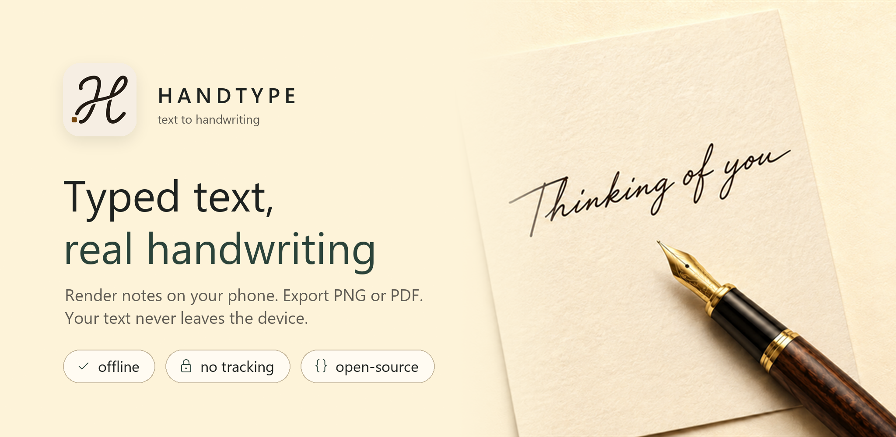
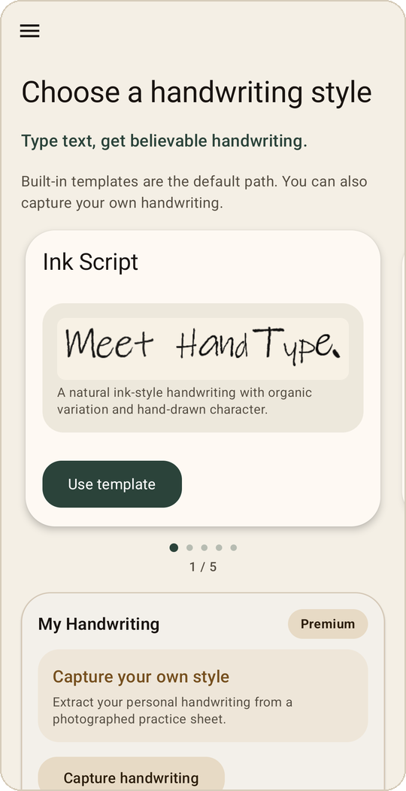
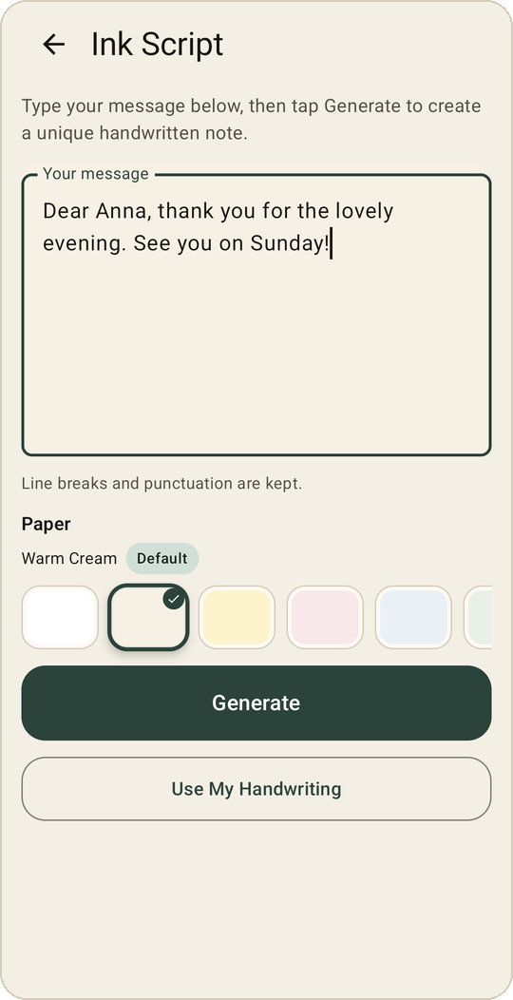
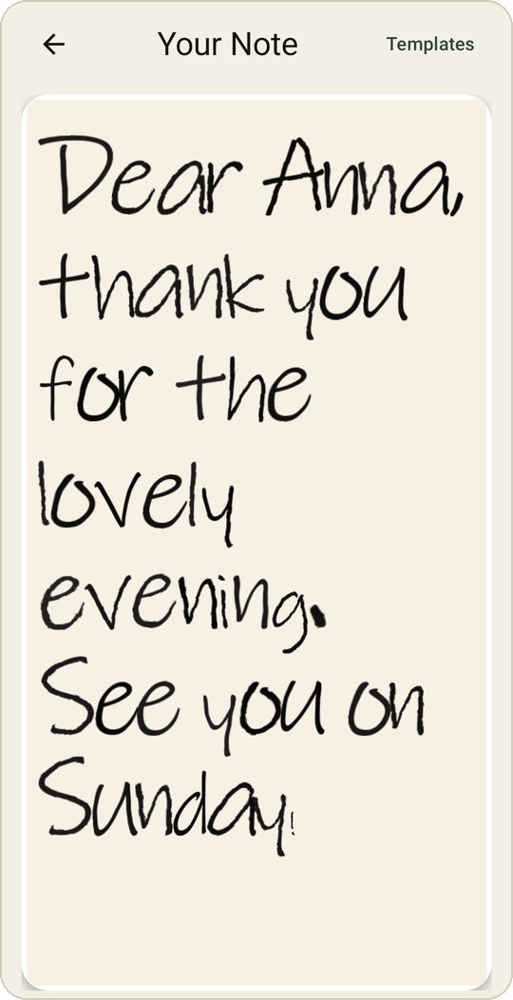
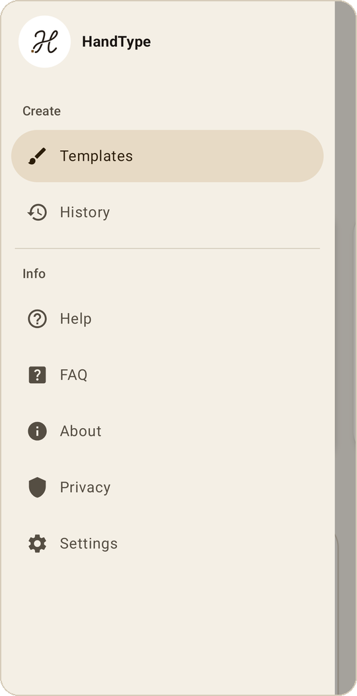

# HandType



Turn typed text into believable handwriting on Android. Rendering, capture and export run on the device; nothing about your text leaves your phone.

<p align="center">
  
  
  
  
</p>

## Features

- Two built-in handwriting styles: **Ink Script** (glyph bitmaps, 8 variants per character) and **Flowing Cursive** (system cursive with per-character jitter, baseline waves and skew)
- Real handwriting feel: per-character rotation, jitter, alpha variation, mesh warp and baseline drift
- 11 paper presets: 6 free (plain white, warm cream, soft butter, rose blush, cool mist, soft sage) and 5 Premium (parchment, recycled, kraft, ruled, graph)
- Save to gallery as PNG, or as transparent PNG without the paper
- Multi-page PDF export with whitespace-aware page breaks
- Share via the system share sheet
- History gallery: every generation is archived locally and can be revisited, re-shared, re-exported or deleted
- Settings for theme (system, light, dark) and app language
- 10 languages: English, German, Spanish, French, Hindi, Japanese, Korean, Portuguese (Brazil), Russian, Chinese (Simplified)

## Premium

Premium is a single one-time purchase through Google Play, with no subscription. It unlocks:

- **My Handwriting**: print the practice sheet, fill it in, scan it with the phone camera, and HandType builds a template from your own letters. The scan and glyph extraction run on-device with ML Kit.
- The 5 Premium papers.

## Privacy

HandType is offline-first and tracker-free.

- No account, no analytics, no crash reporters, no advertising
- No network calls during normal use
- Your text is rendered locally; History is stored only in the app's private storage
- Handwriting capture uses on-device ML Kit; the photo never leaves your device

Full policy: [PRIVACY.md](PRIVACY.md)

## Stack

- Kotlin 1.9.22, Jetpack Compose, Material3
- AGP 8.10.1, Gradle 8.11.1, JDK 17
- minSdk 29 (Android 10), target/compile 36
- ML Kit Document Scanner + text recognition (handwriting capture)
- Google Play Billing (Premium unlock)

## Build

```bash
./gradlew assembleDebug
adb install -r app/build/outputs/apk/debug/app-debug.apk
```

The README banner and screenshots in `docs/images/` are generated by `gen_readme_assets.py` from the store captures in `artifacts/store/`.

## License

Apache License 2.0, see [LICENSE](LICENSE).
